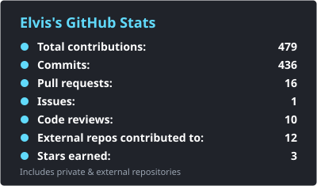
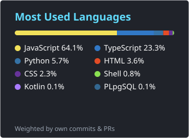

# 👋Elvis Destin OLEMBE

**`Programming Craftsman (Mobile / Web applications)`**

Hello world, Elvis here ! I publish my public work on this profile, so stay tuned...you can also link up with me through X or discord if you want to connect. Thanks ! 

### 🧰 Languages and Tools

  &nbsp;
  &nbsp;
  &nbsp;
  &nbsp;
  &nbsp;
  &nbsp;
  &nbsp;
  &nbsp;
  &nbsp;
  &nbsp;
  &nbsp;
  &nbsp;
  &nbsp;
  &nbsp;
  

### Contact Me

- Email: [elvisolembe1@gmail.com](mailto:elvisolembe1@gmail.com)
- Github: [Github](https://github.com/MrOlmb)

### 📈 Stats
<!-- Cartes générées chaque jour par .github/workflows/profile-stats.yml (repos privés et contributions externes inclus) -->

  
  

